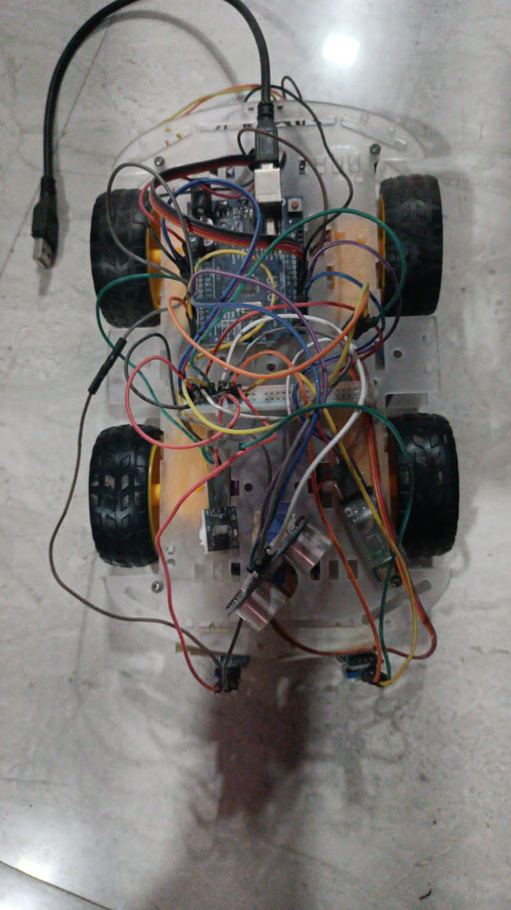
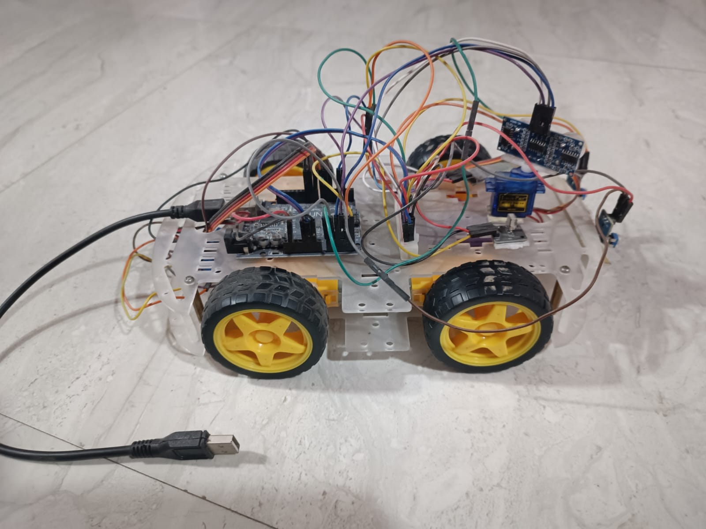
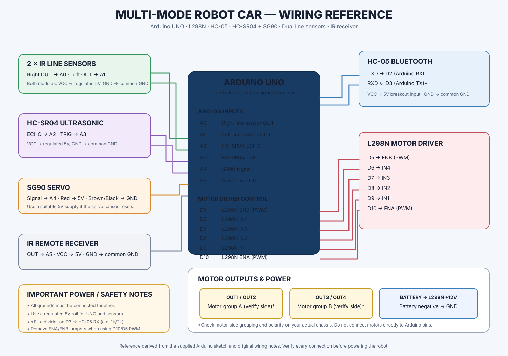

# Multi-Mode Robot Car

An Arduino UNO–based four-wheel robot car with three operating modes: manual control, line following, and ultrasonic obstacle avoidance. The robot accepts commands from both an HC-05 Bluetooth module and an IR remote. In obstacle-avoidance mode, an HC-SR04 ultrasonic sensor is rotated by an SG90 servo to compare the space on the left and right.

> **Hardware note:** This repository documents the supplied `Multimode_Robot_Car.ino` sketch and the accompanying build photographs. Confirm the exact motor grouping, battery arrangement, and power wiring on your own chassis before connecting the battery.

## Project photos

### Top view


### Side view


## Wiring diagram



The diagram is a pin-level reference based on the pin definitions in the sketch and the original wiring notes. It is not a substitute for checking the labels printed on your specific L298N, HC-05, and sensor boards.

## Features

- **Manual drive:** forward, backward, left, right, and stop.
- **Nudge steering:** short left/right turns (400 ms).
- **Line following:** uses two digital-output IR line sensors.
- **Obstacle avoidance:** measures distance with an HC-SR04, scans left/right using an SG90, then turns toward the side with more clearance.
- **Dual control:** commands can arrive through Bluetooth or an IR remote.
- **Adjustable speed:** Bluetooth values greater than 20 are treated as PWM speed values.

## Hardware

| Component | Quantity | Purpose |
|---|---:|---|
| Arduino UNO | 1 | Main controller |
| L298N dual H-bridge driver | 1 | Drives the DC motors |
| DC geared motors and wheels | 4 | Robot drive |
| HC-05 Bluetooth module | 1 | Wireless phone control |
| IR receiver + compatible remote | 1 each | Infrared control |
| HC-SR04 ultrasonic sensor | 1 | Distance measurement |
| SG90 servo | 1 | Turns the ultrasonic sensor |
| IR line-tracking sensor modules | 2 | Line detection |
| Battery pack | 1 | Motor power source |
| Chassis, jumper wires, switch | As required | Mechanical/electrical assembly |

## Pin connections

### Arduino UNO pin map

| Arduino pin | Connected module pin | Function |
|---|---|---|
| D2 | HC-05 TXD | Bluetooth serial receive |
| D3 | HC-05 RXD | Bluetooth serial transmit; use a voltage divider |
| D5 | L298N ENB | Motor channel B PWM |
| D6 | L298N IN4 | Motor direction |
| D7 | L298N IN3 | Motor direction |
| D8 | L298N IN2 | Motor direction |
| D9 | L298N IN1 | Motor direction |
| D10 | L298N ENA | Motor channel A PWM |
| A0 | Right line sensor OUT | Right line detection |
| A1 | Left line sensor OUT | Left line detection |
| A2 | HC-SR04 ECHO | Ultrasonic echo input |
| A3 | HC-SR04 TRIG | Ultrasonic trigger output |
| A4 | SG90 signal | Servo control signal |
| A5 | IR receiver OUT | IR remote input |

### Power and wiring precautions

1. Connect **all grounds together**: Arduino, motor driver, sensor modules, Bluetooth module, servo supply, and battery negative.
2. The HC-05 RX input is a logic-level input. The sketch's wiring notes call for a resistor divider between Arduino D3 and HC-05 RXD (for example, 1 kΩ from D3 to RXD and 2 kΩ from RXD to GND). Check your breakout board's documentation.
3. Power the Arduino and sensors from a stable, regulated 5 V source. Do not assume the L298N 5 V terminal is a suitable output for every battery/motor-driver configuration. Check the board's regulator jumper and documentation. A separate regulated 5 V buck converter is a good option.
4. Power the motors from the motor driver's motor-supply input, within the ratings of the motors and L298N. Do not power motors from the Arduino 5 V pin.
5. A servo can draw current spikes. If the Arduino resets or the servo jitters, use a separate regulated 5 V servo supply and connect its ground to the common ground.
6. Remove the L298N ENA/ENB jumpers if you are controlling ENA and ENB from Arduino PWM pins D10 and D5.
7. Verify the motor output grouping and direction on the actual robot. The sketch and original diagram do not independently prove which physical wheels are connected to each L298N output pair.
8. Test with the wheels lifted off the ground first. Keep fingers clear of the wheels and switch off power before changing wiring.

## Software requirements

- Arduino IDE (or Arduino CLI)
- Arduino UNO board package
- `IRremote` library, version 4.x
- `SoftwareSerial` (included with the standard Arduino AVR core)

`SoftwareSerial` is included with the Arduino AVR core; it does not need a separate library installation.

## Uploading the code

1. Install/open the Arduino IDE.
2. Install the **IRremote** library (4.x) from Library Manager.
3. Open `Multimode_Robot_Car.ino`.
4. Select **Tools → Board → Arduino AVR Boards → Arduino Uno**.
5. Select the correct port under **Tools → Port**.
6. Temporarily disconnect the HC-05 wires from D2 and D3 while uploading, as noted in the sketch.
7. Click **Verify**, then **Upload**.
8. Reconnect the HC-05 and open Serial Monitor at **9600 baud** for debug messages.

## Controls and operating modes

The sketch uses the same command-byte values for Bluetooth and IR input.

| Byte | Command |
|---:|---|
| 1 | Forward |
| 2 | Backward |
| 3 | Left |
| 4 | Right |
| 5 | Stop |
| 6 | Nudge left (400 ms) |
| 7 | Nudge right (400 ms) |
| 8 | Manual mode |
| 9 | Line-follow mode |
| 10 | Obstacle-avoidance mode |
| 21–255 | Set motor PWM speed (values above 20) |

The Bluetooth phone app must send these numeric byte values. Voice control is performed by the phone app translating spoken commands into the same bytes; voice recognition is not implemented on the Arduino itself.

### Mode behaviour

- **Manual:** movement commands directly control the motors. Nudge commands stop automatically after 400 ms.
- **Line following:** the sketch treats `HIGH` as “on the black line”. If both sensors are off the line, it drives forward; if only the right sensor sees the line, it spins right; if only the left sensor sees the line, it spins left; if both see the line, it stops. Sensor polarity and alignment may need calibration.
- **Obstacle avoidance:** the robot drives forward while the measured distance is greater than 20 cm. At or below 20 cm, it stops, scans left and right, and turns toward the side with the larger measured distance. If both readings are equal, it backs up briefly and turns right.

## Configuration in the sketch

These values can be adjusted near the top of `Multimode_Robot_Car.ino`:

| Setting | Default |
|---|---:|
| Line-follow speed | 130 PWM |
| Obstacle-avoid speed | 255 PWM |
| Nudge duration | 400 ms |
| Obstacle stop distance | 20 cm |
| No-echo fallback distance | 200 cm |
| Avoidance turn duration | 450 ms |
| Avoidance backup duration | 300 ms |
| Servo center / left / right | 70° / 140° / 0° |

The IR remote raw codes in `IR_KEYS` are examples from the supplied sketch. Replace them with the codes printed by your own remote if its buttons do not work.

## Repository structure

```text
multimode-robot-car/
├── Multimode_Robot_Car.ino
├── README.md
├── hardware/
│   └── wiring-diagram.svg
└── photos/
    ├── top-view.jpeg
    └── side-view.jpeg
```

## Known limitations / calibration

- The line sensor logic assumes `HIGH` means the sensor is over the black line. Some sensor boards use the opposite polarity.
- The IR remote key values are remote-specific and may need to be learned again.
- Servo angles and the left/right scan directions depend on how the servo is mounted.
- L298N voltage drop and current limits can affect motor speed and temperature. Check motor stall current against the driver rating.
- The supplied sketch does not implement battery-voltage monitoring, wireless failsafe timeout, or encoder-based speed control.

## Contributing

Issues and pull requests are welcome. Include your board/module versions, wiring changes, and test conditions when reporting a problem.

## License

No license has been selected for this project yet. Add a `LICENSE` file if you want to grant others explicit permission to reuse, modify, or distribute the code and design.
